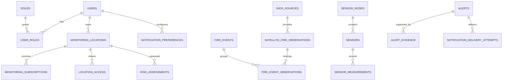

# POLARIS X database design

The Phase 1 schema uses PostgreSQL/PostGIS, SQLAlchemy 2, GeoAlchemy2, and UTC-aware timestamps. All external payloads that need forensic or scientific review retain JSONB provenance.

## Tables

- `users`, `roles`, `user_roles`, `location_access`: identity, multiple roles, and explicit sharing permissions.
- `monitoring_locations`, `hiking_routes`, `monitoring_subscriptions`: monitored points/routes and alert subscriptions. Subscriptions target exactly one point location or one route.
- `data_sources`: source/provider provenance.
- `satellite_fire_observations`, `fire_events`, `fire_event_observations`: raw thermal anomalies separated from derived fire-event groupings. An observation is not a confirmed fire.
- `weather_observations`, `weather_forecasts`: observations and forecasts are intentionally separate.
- `sensor_nodes`, `sensors`, `sensor_measurements`: one current node is supported without limiting future nodes; ADC values remain raw numeric readings.
- `risk_assessments`: model/version, assessment time, feature snapshot, and evidence summary.
- `alerts`, `alert_evidence`, `notification_preferences`, `notification_delivery_attempts`: alert content, supporting evidence, preferences, and delivery tracking.
- `chat_sessions`, `chat_messages`: conversation persistence only; no chatbot service is implemented in Phase 1.

## Integrity decisions

- Coordinates use SRID 4326 geography columns with GiST indexes for proximity queries.
- Acquisition/observation, publication, ingestion, processing, forecast issuance, and validity times are stored separately.
- FIRMS confidence is stored as the original representation, not normalized into an assumed universal scale.
- FRP and brightness temperature are nullable because products differ.
- No notification provider is invoked by this phase.
- Seed data is synthetic and uses an invalid example email domain.

## Mermaid ER diagram

## Assessment provenance

`risk_assessments` stores immutable assessment results with an explicit status, nullable score, model/version, feature snapshot, evidence summary, data-quality details, uncertainty state, and input provenance. Phase 5 currently persists `insufficient_data` results only; no occurrence probability or scientifically calibrated risk score is implied.
